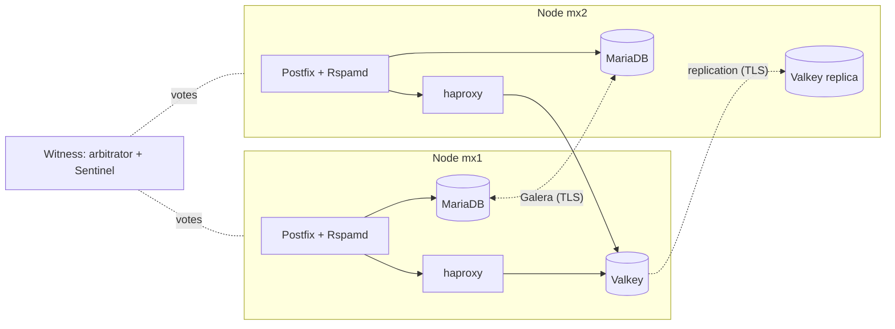

# High availability

Several gateways can run as one cluster. Every full node filters mail on its
own and is its own MX record; what has to be shared is replicated between
them. A node can fail, or be updated, without losing mail or configuration.



## What is shared

| Component | In a cluster |
| --- | --- |
| Database: domains, accounts, lists, quarantine, mail log, statistics, reports, audit log, DKIM keys, settings | MariaDB **Galera**: every node holds a full copy and accepts writes; Postfix and the web interface use the local copy. Plan the mail log's disk space on every node |
| Valkey: Bayes, fuzzy hashes, greylisting, rate limits, outbound counts, rewritten links, history, bans, logs, the SIEM and journal queues | **Replication** with **Sentinel** failover. haproxy on each node forwards `127.0.0.1:6379` to the current master, so clients need no changes |
| Rspamd maps, Postfix relay networks | Every node writes them from the shared database, at most a minute after a change on another node |
| Digests, cleanup, database setup, directory synchronisation, alert checks, sending DMARC reports | Run by one node at a time (a lock in Valkey) |
| SIEM export, journaling | Every node sends from the shared queue |
| Bans | Every node bans what the logs of all nodes report; an unban on any node lifts the ban everywhere |
| Certificates | Each node gets its own; HTTP-01 challenges for names shared by several nodes are answered by whichever node requested them |
| Web interface and API | On every node with the same logins; optionally a floating address (`HA_VIP`) for one shared name |
| Postfix queue, ClamAV, unbound, Rspamd's scan counters, backups, `/metrics` | Per node |
| Hostname, IP addressing, certificate settings, TLS versions | Per node in `crassostrea.conf`; the web interface does not change them on a member |
| Report and reporting addresses (`reports@`, `spam@`, `ham@`) | Each node accepts them at its own hostname |

Replication uses **TLS with a private cluster CA** (`/etc/pki/crassostrea/`)
that setup creates. Nodes and Valkey clients authenticate with certificates
from it; a host with a certificate from another CA cannot join. The cluster
ports are only opened to the other members (firewalld zone
`crassostrea-cluster`).

## Quorum

Every member has one vote. The database only accepts writes, and Valkey only
fails over, while a **majority** of the votes is reachable: a node that is cut
off from the others stops instead of diverging. A cluster therefore survives
the failure of a member only from three votes on:

- **Full nodes only**: three or more nodes.
- **Full nodes and a witness**: two (or any even number of) nodes plus a small
  host that only votes. The witness runs the Galera arbitrator (`garbd`) and a
  Valkey Sentinel, receives no mail and holds no data; 1 CPU and 512 MiB are
  enough. Put it in a third location, so it decides which side of a network
  split continues.

With an odd number of votes the cluster survives the loss of
`(votes - 1) / 2` members, e.g. one of three. Like Proxmox, a cluster may
start with one node and grow: with one or two votes it works, but a failure
stops it (with two nodes, either node's failure stops both). A cluster of one
node (no witness) starts its database on its own after a reboot or a restart,
like a single gateway: having nobody to join, it forms the cluster again at
every start. Monitoring → Cluster,
Settings → Cluster and `configure.sh` warn until there are three votes; with an even number they
warn about network splits.

Members can be added and removed at any time, see
[Changing the members](#changing-the-members).

## Requirements

- The members reach each other on **fixed IPv4 addresses**, ideally on a
  private network or VPN.
- **Low latency** between the nodes: every database write waits for the other
  nodes, so keep them in one region.
- The full nodes meet the normal [requirements](requirements.md).
- For `HA_VIP`, the nodes share the network segment of the floating address
  (see [Floating address](#floating-address)).

Ports between the members, opened automatically and only for the members:

| Port | Use | Members |
| --- | --- | --- |
| 4567/tcp | Galera replication | nodes, witness |
| 4568/tcp | Galera incremental state transfer | nodes |
| 4444/tcp | Galera full state transfer (mariabackup) | nodes |
| 6380/tcp | Valkey (TLS) | nodes |
| 26379/tcp | Sentinel (TLS) | nodes, witness |
| 25, 80, 443/tcp | Mail, ACME challenges, web | nodes |
| VRRP | keepalived (only with `HA_VIP`) | nodes |

## Setting up a cluster

Like a Proxmox cluster, a cluster is built in the web interface: create it on
one gateway, then join the others to it one after another. Install every
gateway first (`setup.sh`, see [Installation](installation.md)).

### In the web interface

1. **Create the cluster.** On the first gateway, **Settings → Cluster** shows
   **Create a cluster**: choose this server's **cluster address** (the IPv4
   address on which the members reach each other, ideally on a private
   network) and optionally a [floating address](#floating-address). The gateway
   keeps its domains, settings and data; it installs the database cluster,
   Valkey replication and the cluster CA, and restarts its services (the web
   interface too: reload the page). This takes a few minutes; the page shows
   the progress and the log.
2. **Join information.** Under Settings → Cluster of a member, **Add a node →
   Join information** shows a text starting with `sfjoin1.`. It names the
   member (hostname, cluster address), the SHA-256 fingerprint of its HTTPS
   certificate and a one-time secret; it works once, for an hour. Treat it like
   a password.
3. **Join.** Under Settings → Cluster of the new gateway, **Join a cluster**: paste the
   join information and choose this server's cluster address. Its root service
   (`crassostrea-cluster-setup`) contacts the member over HTTPS at the member's
   cluster address, accepted only with the certificate of the fingerprint. The
   member adds the new gateway to the cluster's membership; **every member
   then opens its firewall and updates its configuration by itself** (Galera,
   haproxy, Sentinel's quorum, keepalived). The member hands out the join bundle
   (configuration, passwords, cluster CA), and the new gateway installs it with
   `setup.sh --join`: it copies the database (mariabackup over TLS) and Valkey
   from the running nodes. Several minutes; the page shows the progress.

!!! warning
    Joining **replaces** the joining gateway's domains, accounts, settings,
    quarantine, mail log and learned data with the cluster's. Its own name, IP
    families, TLS versions and certificate settings stay. Afterwards log in
    with an account of the cluster.

The same in the API: `POST /api/v1/cluster/create`,
`POST /api/v1/cluster/join-information` (on a member),
`POST /api/v1/cluster/join` (on the new gateway), `GET /api/v1/cluster` for the
progress (`setup`).

Add a third node (or a [witness](#a-witness-host)) for a cluster that
survives a failure.

### On the command line

The first node, on a new host or an installed gateway (which keeps its data):

```bash
sudo ./setup.sh --ha
```

It asks for the full nodes as `hostname=address` (this one first; one node is
enough, the others can join later), the quorum mode with an optional witness,
and an optional floating address. Unattended:

```bash
sudo ./setup.sh --hostname mx1.example.com --yes --ha \
  --ha-nodes mx1.example.com=10.0.0.1,mx2.example.com=10.0.0.2 \
  --ha-witness witness.example.com=10.0.0.3 --ha-vip none
```

It leaves a **join bundle** per listed member in
`/root/crassostrea-join-<hostname>.tar` (also `system/cluster.sh bundle
HOSTNAME` on a full node). It contains the configuration with all passwords and
the cluster CA: copy it securely (e.g. `scp`) and delete it afterwards. On each
other member, one after another:

```bash
git clone https://github.com/SnailShea/crassostrea.git /opt/crassostrea && cd /opt/crassostrea
sudo ./setup.sh --join /root/crassostrea-join-mx2.example.com.tar
```

### A witness host

The witness runs no web interface: it is added on the command line. On a full
node, add it to the members (the other nodes apply it by themselves) and
create its bundle:

```bash
sudo system/cluster.sh members --nodes <the nodes> --witness witness.example.com=10.0.0.3
sudo system/cluster.sh bundle witness.example.com
```

then `sudo ./setup.sh --join /root/crassostrea-join-witness.example.com.tar` on
the witness. It does not see later changes of the nodes by itself: after
adding or removing a node, run `system/cluster.sh members` there too; the
Settings → Cluster shows the command with the current members.

### DNS and names

- One **MX record per full node**. Equal preference shares the load; different
  preferences make one node the primary.
- **A and PTR records** for every node.
- For links in digest mails, set `WEB_PUBLIC_URL` (on all nodes) to a name
  that always works: the floating address, or a name with the addresses of all
  nodes. Add it to `ADDITIONAL_SAN` so the certificates cover it. nginx answers
  only to configured names: the floating address must be used through such a
  name, not as an IP address.

### Floating address

With `HA_VIP` (e.g. `192.0.2.10/24`), keepalived keeps the address on one
node whose nginx, web interface and database copy are healthy. It moves when
that node fails and stays where it is when the node comes back (no flapping).
Mail does not need it: senders use the MX records.

The nodes agree among themselves which one holds the address (VRRP, sent
directly to the other nodes' cluster addresses); the router needs no
configuration. Other hosts find the address like any other on their network,
by ARP: the node holding it answers, and the node taking it over announces
itself with a gratuitous ARP, which the router and the other hosts follow
within a second. This needs:

- an unused address in a subnet the nodes are directly on, outside the range
  of any DHCP server there;
- a network that accepts gratuitous ARP. Most cloud and VPS networks only
  deliver addresses they assigned (use the provider's floating IP instead), as
  do some hypervisors with strict port security.

#### Cluster and public network

With two networks, a private one for the cluster and a public one for mail
and the web, `HA_NODES` has the private addresses and the floating address
belongs to the public network. Set `HA_VIP_INTERFACE` to the public interface
on every node: VRRP stays on the interface with the node's cluster address,
the address is added to the public one, and a node whose public interface
goes down gives it up.

| | Public network | Cluster network |
| --- | --- | --- |
| Addresses | each node's own address (MX, A, PTR records); the floating address | `HA_NODES` |
| Traffic | SMTP, HTTP and HTTPS | Galera, Valkey, Sentinel, VRRP |

If the router reaches the nodes by port forwarding (NAT) rather than directly,
forward the web ports to the floating address.

If the cluster network fails while both nodes keep their public interface,
VRRP cannot tell and both take the address; the health check then removes it
from every node whose database copy lost the majority, so with a witness or
three nodes one node keeps it.

## Day-to-day

`crassostrea.conf` is the same on all members except `CRASSOSTREA_HOSTNAME`
(and, if you set them differently, the TLS versions).
Settings you change (e.g. `SKIP_CLAMD`) have to be changed on every node,
followed by `system/configure.sh` there. A member restarts its database,
Valkey and Sentinel only when their configuration changed, so running
`configure.sh` does not cause a failover.

**Update** the members one at a time, so the others keep the majority (a
cluster of one or two nodes stops while one is updated), each
in [maintenance](#maintenance): maintenance on, wait until its queue is empty,
`update.sh`, check on Monitoring → Cluster that it is in sync, maintenance off.

| Task | Command |
| --- | --- |
| State of the cluster | **Monitoring → Cluster** ([Cluster page](#cluster-page)), or `sudo system/cluster.sh status` |
| Maintenance | **Maintenance** under Settings → Cluster, or `sudo system/cluster.sh maintenance on\|off [<hostname>]` |
| Add a node | Join information under Settings → Cluster, **Join a cluster** there on the new gateway |
| Remove a node that is switched off | **Remove** under Settings → Cluster |
| Join bundle for a member | `sudo system/cluster.sh bundle <hostname>` |
| Start the database after all nodes were down | `sudo system/cluster.sh bootstrap` |
| Leave the cluster (before removing a member) | `sudo system/cluster.sh leave` |

The mail queue, the service list (Monitoring) and the logs other than the
Postfix log are those of the node you are logged in to; the Cluster page shows
every node, and the Postfix log, the mail log and the dashboard's statistics
show all nodes.

**Backups** are made on every node; a member is never restored from one (see
[Backups](backups.md#clusters)). **Renaming a member** means replacing it:
`leave`, `members` without it, then join a host with the new name.

## Cluster page

**Monitoring → Cluster** shows the cluster from the reports of its nodes, on any
node; maintenance, the Valkey master and the members are managed under
**Settings → Cluster**. It updates itself every 10 seconds:

- the overall state (healthy, degraded, critical), the votes in the database
  cluster and the majority they need, the nodes reporting, the Valkey master
  and the node holding the floating address;
- the **problems** (below), and the nodes in maintenance;
- per member: its address, when it last reported, its database state, its
  Valkey role (with how far a replica is behind) and whether its Sentinel
  reaches a majority, whether it accepts mail, its mail queue, Rspamd's scan
  count, stopped services, load, memory, disk use, uptime and the deployed
  version (git commit); for the witness, whether its Sentinel answers and its
  arbitrator counts.

Every node reports every 10 seconds: `crassostrea-cluster-report.service`
writes its row of the shared database (`cluster_reports`), including what the
root service `crassostrea-cluster.service` finds with the cluster certificate
(Valkey, Sentinel, the floating address). A node that has not reported for a
minute counts as missing. The witness runs no web interface: it is seen through
the nodes (its Sentinel answers them; the arbitrator is counted from the
database cluster's size).

| Problem | Level |
| --- | --- |
| A node has not reported for a minute (or never) | critical |
| A node's database is not in the primary component / not synced | critical / warning |
| The database cluster has fewer votes than members, or no majority | warning / critical |
| No node, or more than one, is the Valkey master | critical |
| A Valkey replica is not connected to the master; a Sentinel cannot reach a majority | warning |
| The witness's Sentinel does not answer, or its arbitrator is not counted | warning |
| The floating address is on no node / on several nodes | warning / critical |
| The nodes run different versions for more than an hour | warning |
| A filesystem is 90% full | warning |
| Maintenance was requested a minute ago but is not in effect | warning |
| No node accepts mail (all in maintenance or out of sync) | critical |
| A node's cluster service (`crassostrea-cluster`) does not report | warning |

The [alert mail](monitoring.md#alert-mail) reports the same problems, and
`/metrics` has them as [`sf_cluster_*`](monitoring.md#prometheus).
API: `GET /api/v1/cluster`.

## Maintenance

A node in maintenance:

- answers new SMTP connections with `421 4.3.2` (a temporary error), so
  senders deliver to the other MX hosts; relay clients that only know this
  node retry later;
- hands the Valkey master over to another node and is never made master
  (`replica-priority 0`, kept across restarts);
- fails the keepalived health check, so the floating address moves;
- keeps delivering the mail in its queue, and its web interface keeps working.

Turn it on with **Maintenance** under **Settings → Cluster** (on any node, for any node),
`PUT /api/v1/cluster/nodes/<hostname>/maintenance` with `{"enabled": true}`, or
`sudo system/cluster.sh maintenance on [<hostname>]` (`off` to end it). It is
refused when no other node is reporting, in sync and out of maintenance, as
nobody would accept mail; `--force` (API: `"force": true`) does it anyway. The
node applies it within seconds; the page shows *entering maintenance* until
it is in effect.

The request is stored in the database (`cluster_control`), so it survives
restarts and applies to a node that is down once it returns. Each node's
`crassostrea-cluster.service` (`system/libexec/cluster-node`) carries it out
and checks every 10 seconds that it is still in effect.

### Valkey master

**Make Valkey master** (or `POST /api/v1/cluster/nodes/<hostname>/valkey-master`)
moves the Valkey master to a node whose replica is connected, e.g. back to
the preferred node after maintenance. The node raises its priority and asks
Sentinel for a failover: it takes about 30 seconds, clients reconnect through
haproxy within a second or two.

## Changing the members

The membership is stored in the cluster's database (`cluster_membership`):
every node applies a change by itself within a minute (`HA_NODES` and
`HA_WITNESS` in its `crassostrea.conf`, firewall, Galera, haproxy, Sentinel,
keepalived; done by `crassostrea-cluster`, without restarting the database).

**Add a node**: [join it](#setting-up-a-cluster) with a join information.

**Remove a node**, like `pvecm delnode`: switch it off for good (or run
`sudo system/cluster.sh leave` on it, which stops and disables its services),
then **Remove** next to it under Settings → Cluster of another node (also
`DELETE /api/v1/cluster/nodes/<hostname>`). Only a node that has not reported
for a minute can be removed. Do not start it again with this cluster's data:
reinstall it to use it again.

**Add or remove the witness**: on a full node, `sudo system/cluster.sh members
--nodes <nodes> --witness host=address` (then join the witness with its
bundle) or `--no-witness` (then `leave` on the witness). Settings → Cluster can
also remove the witness.

On the command line, `system/cluster.sh members --nodes ...` changes the
membership for every node as well (it writes the database); a node whose
database does not answer is changed only itself.

**Back to a single gateway.** After the other members left, run
`sudo system/cluster.sh members --standalone` on the remaining node; it can
create a new cluster later.

## Failures

| Situation | What happens |
| --- | --- |
| A node fails | Senders retry the other MX records; the remaining majority continues. If it was the Valkey master, another node takes over, usually after about 10 seconds (at most about 30). Mail in the failed node's queue waits for its return. When it is back, it catches up on the database and Valkey by itself and comes back as a Valkey replica |
| A node is cut off | It loses the majority, refuses database queries and temporarily rejects mail (4xx), so senders retry another MX |
| The witness fails | Nothing visible while all nodes run; the cluster cannot survive another failure until it is back |
| All nodes stop (power loss) | MariaDB does not start on its own, as no node knows whether it has the latest data. See below |

The watchdog reports a degraded cluster (a node not in sync, fewer members than
configured) but never restarts the database of a cluster node. The Cluster
page and the alert mail show which member is affected.

### Recovery after all nodes were down

A cluster of one node needs nothing: it forms the cluster again when it
starts. With several members, run `sudo system/cluster.sh bootstrap` on the
node that stopped last. If that
node did not stop cleanly, the command refuses and shows the node's position
in the database history; compare it with the other nodes (`galera_recovery`
there) and run `system/cluster.sh bootstrap --force` on the most advanced one.
Then start MariaDB on the others: `sudo systemctl start mariadb`.
