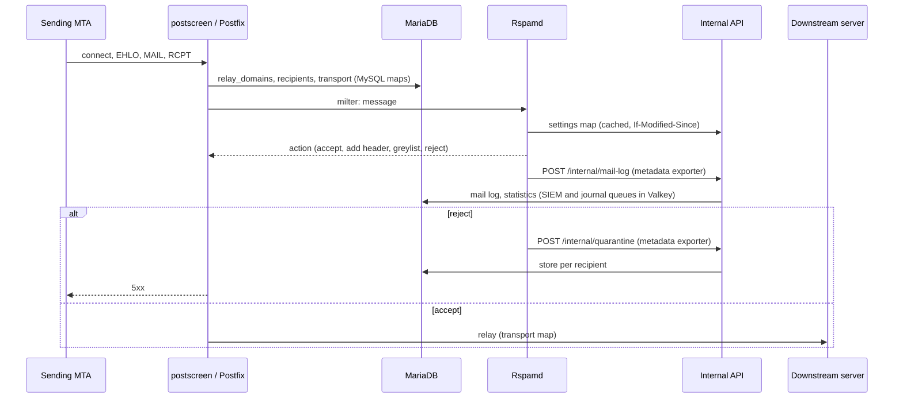
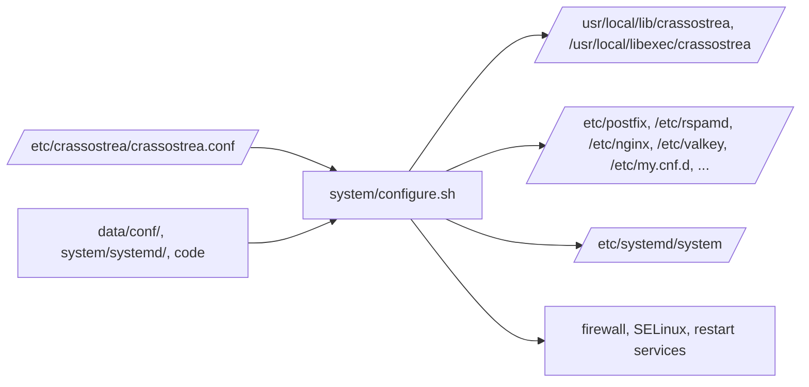

# Architecture

## Process model

Crassostrea is a set of distribution services (Postfix, Rspamd, ClamAV,
MariaDB, Valkey, unbound, nginx) configured by shell scripts, plus a few
programs of its own, all as systemd units on one EL10 host:

| Program | Language | Runs as | Role |
| --- | --- | --- | --- |
| Web interface (`crassostrea-web`) | Python, Flask, gunicorn | `crassostrea` | Admin UI, mailbox user portal, digest links, REST API, link protection (`/l/`), `/metrics` |
| Internal API (`crassostrea-web-internal`) | same code, `create_app("internal")` | `crassostrea` | For Rspamd, loopback only: settings map, quarantine, mail log, DMARC/TLS reports, user reports |
| Jobs (`crassostrea-job@<command>`) | Flask CLI | `crassostrea` | `cleanup`, `sync`, `send-digests`, `provision-accounts`, `sync-directories`, `check-alerts`, `init-db` |
| SIEM and journal senders (`crassostrea-siem`, `crassostrea-journal`) | Flask CLI, long-running | `crassostrea` | `siem-forward`, `journal-send`: drain queues in Valkey |
| Cluster report (`crassostrea-cluster-report`) | Flask CLI, long-running | `crassostrea` | Cluster nodes: `cluster-report` writes the node's state into the database and its maintenance requests for `cluster-node` |
| cluster-node (`crassostrea-cluster`) | Bash, long-running | root | Cluster nodes: probes Valkey and Sentinel over TLS, applies maintenance and Valkey master changes |
| Postfix control (`crassostrea-postfix-control@`) | Python | root, per connection | Mail queue actions for the web UI |
| Log reader (`crassostrea-logs@`) | Python | root, per connection | The journal of the services for the Logs page; only the units it lists |
| Root services of the web UI | Bash, Python | root, per request | `set-hostname`, `set-timezone`, `tls-apply`, `network-apply`, `backup request`, `postfix-apply`: started by path units when the web UI writes a request (see [Design decisions](design.md#root-services-for-the-web-ui)) |
| backup, dmarc-report | Bash | root | Nightly backup and pruning, daily DMARC reports |
| logship | Python | `crassostrea` + `systemd-journal` | Mail log from journald to Valkey; refused recipients and delivery results to the internal API |
| netfilter | Python | root | Bans in nftables |
| Watchdog | Bash | root | Health checks, restarts, notifications |
| acme, sa-rules, clamav-sigs | Bash | root | Certificate and rule/signature updates |
| valkey-role | Bash | root (ExecStartPre) | Cluster: start Valkey as replica of the current master |
| configure.sh, install.sh, setup.sh, cluster.sh | Bash | root | Installation, configuration rendering, cluster management |

## How a message flows

- **Postfix** reads `domains` and `recipients` directly through MySQL lookup
  maps (relay domains, transport, recipient validation), so changes in the
  database are effective immediately.
- **Rspamd** gets per-domain and per-user thresholds and allow/block lists as
  a **settings map** from the internal API, which renders it from the
  database. Global lists, protected domains and relay networks are **map
  files** under `/etc/rspamd/custom/`, written by the web app and reloaded by
  Rspamd automatically.
- **The gateway's own checks** (content rules, attachment policy, hash
  lookups, impersonation, outbound limits, data loss prevention, link
  rewriting) are Lua in `data/conf/rspamd/lua/rspamd.local.lua`, configured by
  JSON or key-value maps the web app writes to `/etc/rspamd/custom/`; their
  state (counters, link ids, hash verdicts, API keys) is in Valkey.
- **Mail log and quarantine**: Rspamd's metadata exporter posts every message
  for a protected domain or from a relay network to the internal API (mail
  log, with hourly statistics), and rejected messages again for the
  quarantine, which stores one row per recipient (with size limit and the
  outbound/inbound distinction). A prefilter (`SF_MAIL_DIRECTION`) marks the
  direction first, so the filing never depends on which checks ran.
- **Mail for the gateway itself** (`reports@`, `spam@`, `ham@` of the
  hostname): Postfix accepts it (inline maps on `$myhostname`) and discards it
  after Rspamd handed it unfiltered to the internal API.
- **Release**: the web app re-injects the message into Postfix on
  `127.0.0.1:590`, a listener without milter, adding only a header; outbound
  messages are DKIM-signed by the web app with the same key and header list
  Rspamd uses.

## Data

| Store | Contents | Written by |
| --- | --- | --- |
| MariaDB | domains, recipients, list entries, mailbox users, admins (roles, domains, two-factor), API keys (hashed), DKIM keys, quarantine and mail log (with messages and delivery results), statistics, DMARC/TLS and user reports, audit log, directories, outbound limits, DLP and content rules, protected people, digest tokens and state, settings, branding assets | web app |
| Valkey | Rspamd: Bayes, fuzzy, greylisting, rate limits, history, neural, DMARC report data; DKIM keys and hash lookup keys (copies for Rspamd); the gateway's checks: outbound counters, link ids, hash verdicts; `POSTFIX_MAILLOG`; netfilter: `F2B_*`; login throttling; job locks; SIEM and journal queues; alert state | Rspamd, web app, logship, netfilter |
| Files | Rspamd maps in `/etc/rspamd/custom/`, Postfix `relay_networks.cidr` and `message_size_limit` in `/var/lib/crassostrea/postfix/` | web app (`maps.sync_all`) |
| `/etc/crassostrea/crassostrea.conf` | host settings and secrets | setup.sh, cluster.sh, the root services of the web UI (`conf_set`) |
| `/var/lib/crassostrea/` | `web/` (requests of the web UI), `tls/`, `network/` (their outcome), `backups/`, `postfix/` | web app, root services |

The database is the source of truth: map files and the DKIM copy in Valkey are
derived and rewritten by the `sync` job every 10 minutes (every minute in a
cluster) and after every change.

## Configuration rendering

`system/configure.sh` turns `crassostrea.conf` and the files in `data/conf/`
into the configuration of every service:

It is idempotent and runs on every install, update and configuration change.
`SF_ROOT` and `SF_DRYRUN` let it render into a scratch directory without
touching the system (used by the tests).

## Cluster

In a cluster (`HA_NODES`) the same scripts additionally render Galera
settings, Valkey replication with Sentinel, haproxy, keepalived, the arbitrator
on the witness, and a firewalld zone for the members. Details and the reasons
are in [Design decisions](design.md#cluster).
