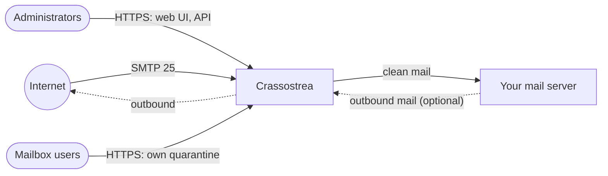

# Crassostrea

Crassostrea is a spam filter gateway: an inbound spam and virus filter (smart
host) that sits in front of your existing mail server. It accepts mail for your
domains, filters it with Rspamd and ClamAV, quarantines what it rejects, and
relays clean mail to the mail server that holds the mailboxes.

It runs directly on an EL10 host (AlmaLinux 10, Rocky Linux 10 or RHEL 10)
with distribution packages and systemd units, no containers. A web interface
and a REST API manage it, and several gateways can form a high availability
cluster.

## Where to start

| You want to | Read |
| --- | --- |
| Understand what it does and how mail flows | [Overview](admin/overview.md) |
| Install a gateway | [Requirements](admin/requirements.md), then [Installation](admin/installation.md) |
| Protect a domain | [Domains and delivery](admin/domains.md), [Recipient directories](admin/directories.md) |
| Tighten the filter | [Filtering](admin/filtering.md), [Threat protection](admin/protection.md), [Outbound mail](admin/outbound.md) |
| Follow mail and trends | [Mail log and statistics](admin/mail-log.md), [DMARC and TLS reports](admin/reports.md) |
| Run several gateways | [High availability](admin/high-availability.md) |
| Automate administration | [REST API](admin/api.md) |
| Keep it running | [Operations](admin/operations.md), [Backups](admin/backups.md), [Monitoring](admin/monitoring.md), [Troubleshooting](admin/troubleshooting.md) |
| Work on the code | [Architecture](developer/architecture.md), [Development environment](developer/environment.md), [Testing](developer/testing.md) |

## Features at a glance

- **Filtering**: Rspamd (Bayes, fuzzy hashes, DNS blocklists, SPF, DKIM,
  DMARC, ARC and many heuristics), ClamAV with Sanesecurity signatures, Olefy
  for Office macros, postscreen in front of Postfix.
- **Per-domain delivery** to the domain's own mail server, with recipient
  validation (accept all, a recipient list, verification with the
  downstream server, or recipients synchronised from LDAP, Active Directory or
  Microsoft 365).
- **Thresholds and allow/block lists** at three levels: global, per domain and
  per mailbox user.
- **Quarantine** of rejected mail with release, download, learning and
  automatic expiry; **digests** with links that open a recipient's quarantine
  without an account.
- **Threat protection**: an attachment policy (also inside archives), hash
  lookups of attachments, impersonation checks (names of protected people,
  look-alike domains, spoofing of your own domains), link protection (links
  checked when clicked) and your own content rules.
- **Mail log** of every scanned message with its score breakdown, text, HTML
  view and headers, re-queueing, and **statistics** over two years.
- **Mailbox users** who manage their own quarantine and filter settings, and
  can **report spam** from their mail client.
- **Outbound relay** for your mail servers, with **DKIM signing**, limits per
  sender and **data loss prevention** rules.
- **DMARC and TLS reports** received and analysed per domain; DMARC reports
  sent about received mail.
- **Journaling** of all mail to an archive.
- **Web interface** with live pages, administrators and domain
  administrators, two-factor login, an audit log, API keys and branding;
  hostname, IP addressing, certificates and TLS versions, and a check of DNS
  and ports, managed there too.
- **Backups** every night, restore and move to a new server.
- **Monitoring**: Prometheus metrics, events to a SIEM, alert mail.
- **REST API** for everything the web interface manages, documented with
  OpenAPI.
- **High availability**: clusters with a replicated database and Valkey,
  automatic failover and a selectable quorum mode.
